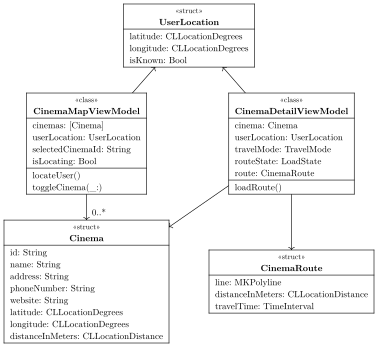
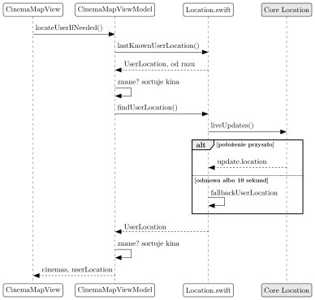

# Lab 6: kina na mapie (MapKit)

Na tych zajęciach aplikacja dostaje zakładkę Cinemas: kina Wrocławia na mapie i na liście, najbliższe na górze. Kino ma swój ekran z trasą. Film, który jest teraz w kinach, dostaje przycisk "Now in Cinemas".

Cały kod piszą Państwo sami. Nazwy plików, typów i funkcji proszę zachować, bo według nich sprawdzam prace.

## Zanim Państwo zaczną

1. Lab 6 korzysta z kodu z lab 5: zakładka Cinemas trafia do AppTabs. Bez lab 5 proszę ją dodać we własnym TabView, obok Saved.
2. Położenie w symulatorze: menu Features, Location, Custom Location, wpisać 51.0983 i 17.0368 (Wrocław Główny).
3. Nowy plik: w Xcode prawy klik na folder w Project navigator, New File from Template, Swift File. Xcode sam dodaje go do aplikacji albo do testów, zależnie od folderu.

## Pliki

Nowe:

```
MyNextMovie/Models/Cinema.swift
MyNextMovie/Models/WroclawCinemas.swift        gotowy, z docs/files
MyNextMovie/Models/MapRegion.swift
MyNextMovie/Services/Location.swift
MyNextMovie/Services/Maps.swift
MyNextMovie/ViewModels/CinemaMapViewModel.swift
MyNextMovie/ViewModels/CinemaDetailViewModel.swift
MyNextMovie/Views/CinemaMapView.swift
MyNextMovie/Views/CinemaDetailView.swift
MyNextMovieTests/TestCinemas.swift             gotowy, z docs/files
MyNextMovieTests/CinemaTests.swift
MyNextMovieTests/CinemaMapViewModelTests.swift
```

Do zmiany: Config/App.xcconfig, MyNextMovieApp.swift, Layout.swift, MovieDetails.swift, MovieDetailView.swift, TestMovies.swift, MovieDetailsTests.swift.

## Jak to działa

Lista kin jest wpisana w aplikację, tak jak genreTable, więc pojawia się od razu, także bez internetu. Położenie użytkownika tylko ustawia najbliższe kina na górze. Bez zgody na położenie wszystko działa, a kina są po nazwie.

Typy z tego labu (diagram klas UML). Tylko view modele są klasami:



## Zadanie 1: kina

### Models/Cinema.swift

Na górze `import CoreLocation`. Struktury Cinema i UserLocation z diagramu, obie nonisolated. Cinema jest Identifiable i Hashable, UserLocation jest Equatable. W Cinema tylko distanceInMeters jest var, z wartością początkową unknownDistance.

Stałe w tym samym pliku:

```swift
nonisolated let unknownDistance: CLLocationDistance = -1
let noCinemaSelected = ""
let cinemaNotFound = -1
// Rynek, gdy położenie jest nieznane
let fallbackCoordinate = CLLocationCoordinate2D(
    latitude: 51.1100, longitude: 17.0320)
let fallbackUserLocation = UserLocation(
    latitude: fallbackCoordinate.latitude,
    longitude: fallbackCoordinate.longitude,
    isKnown: false)
```

Funkcje w tym samym pliku:

| Funkcja | Co robi |
| --- | --- |
| cinemaCoordinate, userCoordinate | położenie jako CLLocationCoordinate2D |
| distanceInMeters(from:to:) | odległość w linii prostej (CLLocation.distance(from:)) |
| cinemasSortedByDistance(\_:from:) | kina z odległością, najbliższe pierwsze |
| isCloser(\_:\_:) | bliższe pierwsze, przy remisie po nazwie |
| positionOfCinema(\_:cinemaId:), containsCinema | szukanie kina po id |
| formattedDistance(\_:) | "850 m", "2.4 km", pusty tekst dla unknownDistance |
| phoneURL, hasPhoneNumber | link tel: z samymi cyframi i plusem |
| websiteURL, hasWebsite | strona kina |

### Models/WroclawCinemas.swift

Gotowy plik z danymi siedmiu kin z Apple Maps. Proszę skopiować docs/files/WroclawCinemas.swift do MyNextMovie/Models/.

### Models/MapRegion.swift

Na górze `import MapKit`. Obszar, na którym widać wszystkie kina:

```swift
let wroclawMapRegion = MKCoordinateRegion(
    center: CLLocationCoordinate2D(
        latitude: 51.0956, longitude: 17.0230),
    latitudinalMeters: 15500,
    longitudinalMeters: 14000)
```

Do tego regionMoved(\_:to:) (ten sam rozmiar, nowy środek) i isInRegion(\_:\_:).

### Testy

Proszę skopiować docs/files/TestCinemas.swift do MyNextMovieTests/. Testy w pliku MyNextMovieTests/CinemaTests.swift, w dwóch zestawach:

| CinemaTests | WroclawCinemasTests |
| --- | --- |
| sortsCinemasClosestFirst | everyCinemaIsOnTheStartMap |
| measuresDistanceOfEveryCinema | idsAreUnique |
| sortsCinemasAtTheSameDistanceByName | everyCinemaHasAddressAndWebsite |
| findsPositionOfCinema | pointOutsideRegionIsNotOnTheMap |
| unknownDistanceIsEmptyText | |
| phoneLinkHasOnlyDigits | |
| noPhoneOrWebsiteMeansNoLink | |

Nazwy mówią, co sprawdzają. Np. sortsCinemasClosestFirst: od testUserLocation kolejność to DCF, Nowe Horyzonty, Multikino, Helios.

## Zadanie 2: mapa i położenie

### Config/App.xcconfig

Bez tego iOS nie zapyta o położenie, a aplikacja się zamknie. Na końcu pliku, w jednej linii: klucz INFOPLIST\_KEY\_NSLocationWhenInUseUsageDescription, znak = i tekst pytania: My Next Movie shows the cinemas near you on the map.

### Views/Components/Layout.swift

Nowe stałe, na końcu pliku:

```swift
let symbolNameCinema = "popcorn.fill"
let symbolNameLocationOff = "location.slash"
let symbolNameDirections =
    "arrow.triangle.turn.up.right.diamond.fill"
let symbolNamePhone = "phone.fill"
let symbolNameWebsite = "safari"
let symbolNameWalking = "figure.walk"
let symbolNameDriving = "car.fill"
let symbolNameDetails = "info.circle"
```

### Services/Location.swift

Na górze `import CoreLocation`.

- `findUserLocation() async -> UserLocation`: świeże położenie. Po odmowie albo po 10 sekundach fallbackUserLocation.
- `lastKnownUserLocation() -> UserLocation`: CLLocationManager().location, od razu.

Świeże położenie:

```swift
let session = CLServiceSession(authorization: .whenInUse)
defer { session.invalidate() }
for try await update in CLLocationUpdate.liveUpdates() {
    // update.location albo update.authorizationDenied
}
```

Limit 10 sekund: withTaskGroup z dwoma zadaniami, szukaniem położenia i Task.sleep. Wygrywa to, które skończy się pierwsze.

### Services/Maps.swift

Na górze `import MapKit`. Na razie dwa typy:

```swift
typealias UserLocationFinder = () async -> UserLocation
typealias LastKnownLocationReader = () -> UserLocation
```

### ViewModels/CinemaMapViewModel.swift

Klasa @Observable z diagramu, do tego `var visibleRegion = wroclawMapRegion`.

- init(cinemas:findUserLocation:lastKnownLocation:), ostatni parametr domyślnie `{ fallbackUserLocation }`.
- locateUser(): kroki na diagramie niżej. Nieznane położenie nie zastępuje znanego.
- locateUserIfNeeded(): locateUser() tylko za pierwszym razem.
- toggleCinema(\_:): zaznacza kino albo odznacza zaznaczone.
- isLocationUnavailable: aplikacja pytała, ale położenia nie ma.



### Views/CinemaMapView.swift

Widok CinemaMapView(viewModel:findRoute:placement:). Parametr placement ma typ `enum CinemaMapPlacement { case tab, sheet }`. Tylko w arkuszu jest przycisk "Done".

- Mapa na 45% ekranu: .containerRelativeFrame(.vertical).
- Pod mapą, gdy isLocationUnavailable, szara linia z tekstem "Turn on location to see distances and routes."
- Niżej lista: nazwa, adres, odległość. Wiersz zaznacza kino, a przycisk info (ikona symbolNameDetails) otwiera jego ekran.
- Pinezka zaznacza wiersz i przewija do niego listę (ScrollViewReader). Wiersz przesuwa mapę na kino.

Mapa:

```swift
Map(position: $cameraPosition, selection: $selectedCinemaId) {
    UserAnnotation()
    ForEach(cinemas) { cinema in
        Marker(cinema.name, systemImage: symbolNameCinema,
               coordinate: cinemaCoordinate(cinema))
            .tag(cinema.id)
    }
}
.mapStyle(.standard(emphasis: .muted,
                    pointsOfInterest: .excludingAll))
.mapControls {
    MapUserLocationButton()
    MapCompass()
}
```

### MyNextMovieApp.swift

W AppTabs, w TabView, między Saved i Account:

```swift
Tab("Cinemas", systemImage: symbolNameCinema) { cinemaMap }
```

I nowa właściwość w AppTabs:

```swift
private var cinemaMap: some View {
    let viewModel = CinemaMapViewModel(
        cinemas: wroclawCinemas,
        findUserLocation: findUserLocation,
        lastKnownLocation: lastKnownUserLocation)
    return CinemaMapView(viewModel: viewModel,
        findRoute: findMapKitRoute, placement: .tab)
}
```

Funkcja findMapKitRoute powstaje w zadaniu 3. Do tego czasu można podać `{ _, _, _ in noRoute }`.

### Testy

Zestaw CinemaMapViewModelTests w pliku MyNextMovieTests/CinemaMapViewModelTests.swift. Położenie udają zamknięcia, np. `{ testUserLocation }`:

| Test | Sprawdza |
| --- | --- |
| showsCinemasAtOnceByName | po init kina są po nazwie |
| sortsByDistanceOnceUserIsFound | po locateUser pierwsze jest DCF |
| lastKnownLocationIsUsedWhenNoFreshOneComes | zostaje ostatnie znane |
| freshLocationReplacesLastKnownOne | świeże wygrywa |
| saysWhenLocationIsUnavailable | isLocationUnavailable |
| asksForLocationOnlyOnce | jedno pytanie o położenie |
| togglesSelection | drugie kliknięcie odznacza |

Proszę sprawdzić w aplikacji: lista ma odległości, pinezka zaznacza wiersz, a po odmowie (Settings, Privacy & Security, Location Services) lista jest po nazwie.

## Zadanie 3: ekran kina

### Services/Maps.swift

Dalej:

```swift
enum TravelMode { case walking, driving }
typealias CinemaRouteFinder = (UserLocation, Cinema, TravelMode)
    async throws -> CinemaRoute
```

Do tego struktura CinemaRoute z diagramu, stała noRoute z pustą trasą i błąd NoRouteFound (LocalizedError) z tekstem "Maps found no way to this cinema."

| Funkcja | Co robi |
| --- | --- |
| findMapKitRoute(userLocation:cinema:travelMode:) | pierwsza trasa z MKDirections(request:).calculate() |
| mapItemForCinema(\_:) | MKMapItem(location:address:) z nazwą kina |
| transportTypeForMapKit(\_:) | .walking albo .automobile |
| openCinemaInMaps(\_:travelMode:) | openInMaps(launchOptions:) z trasą |
| findLookAroundScene(\_:) | MKLookAroundSceneRequest, nil gdy nie ma zdjęć |

### ViewModels/CinemaDetailViewModel.swift

Klasa @Observable z diagramu, do tego pole errorMessage i init(cinema:userLocation:findRoute:).

- canFindRoute: położenie jest znane.
- loadRoute(): bez położenia nic nie robi. Inaczej routeState przechodzi .loading, potem .loaded albo .failed z errorMessage.
- formattedTravelTime(\_:) daje "12 min". routeSummary(\_:) daje czas i odległość, np. 12 min i 950 m, rozdzielone kropką w środku linii: `" \u{00B7} "`.

### Views/CinemaDetailView.swift

List z sekcjami:

1. mapa z pinezką kina i trasą MapPolyline(viewModel.route.line),
2. adres i odległość,
3. "Way There": Picker "Walk" albo "Drive" i routeSummary,
4. "Directions in Maps", telefon (Link z phoneURL) i strona,
5. "Look Around": LookAroundPreview, gdy są zdjęcia.

Na liście trasa liczy się od nowa po każdej zmianie Walk i Drive:

```swift
.task(id: viewModel.travelMode) { await viewModel.loadRoute() }
```

W CinemaMapView przycisk info dodaje kino do ścieżki NavigationStack, a `.navigationDestination(for: Cinema.self)` otwiera CinemaDetailView.

### Testy

W pliku CinemaMapViewModelTests.swift zestaw CinemaDetailViewModelTests: findsNoRouteWithoutLocation, findsRouteForSelectedTravelMode, showsErrorWhenRouteFails, routeSummaryHasTimeAndDistance. W pliku CinemaTests.swift zestaw MapKitConversionTests: mapItemForCinemaKeepsNameAndPosition, travelModeBecomesMapKitTransportType.

Proszę sprawdzić w aplikacji: widać trasę od dworca, Drive daje inną trasę, a "Directions in Maps" otwiera Apple Maps.

## Zadanie 4: film w kinach

TMDB nie zna repertuaru, ale zna datę i typ premiery w każdym kraju. Film zwykle gra kilka tygodni. Przycisk pokazujemy, gdy premiera kinowa w Polsce była najwyżej 42 dni temu.

### Models/MovieDetails.swift

ReleaseDate dostaje dwa pola. TMDB już je wysyła w tej samej odpowiedzi co ograniczenie wiekowe z lab 3:

```swift
nonisolated struct ReleaseDate: Decodable {
    let certification: String
    let releaseDate: String  // "2026-10-17T00:00:00.000Z"
    let type: Int  // 2 i 3 to premiera kinowa
}

let releaseTypeTheatricalLimited = 2
let releaseTypeTheatrical = 3
let typicalCinemaRunInDays = 42
```

- `isInCinemas(_ details:regionCode:today:) -> Bool`: premiera typu 2 albo 3 w kraju regionCode, od 0 do 42 dni przed today.
- `daysSinceReleaseDay(_ releaseDate:today:) -> Int`: dni od premiery, `-1` dla złej albo przyszłej daty. Dzień to 10 pierwszych znaków, czytany przez Date.ISO8601FormatStyle.

### MyNextMovieTests/TestMovies.swift

Każde ReleaseDate(...) dostaje releaseDate: i type:, inaczej testy się nie skompilują.

### Views/MovieDetailView.swift

W body, w VStack między MovieInfo a sekcjami:

```swift
if isInCinemas(viewModel.details,
               regionCode: watchRegionCode, today: Date.now) {
    // przycisk "Now in Cinemas" i pod nim
    // "See the cinemas near you. Showtimes are on each
    // cinema's website."
}
```

Przycisk ustawia `@State var isShowingCinemas`. `.sheet(isPresented: $isShowingCinemas)` pokazuje CinemaMapView z `placement: .sheet`, zbudowany jak w AppTabs.

### Testy

Zestaw InCinemasTests w pliku MovieDetailsTests.swift. Dzisiejszy dzień to w nich 6 listopada 2026, czyli `Date(timeIntervalSince1970: 1_793_923_200)`. Testy: recentCinemaPremiereIsInCinemas, limitedReleaseCountsToo, oldPremiereIsNotInCinemas, futurePremiereIsNotInCinemasYet, digitalReleaseIsNotCinema (typ 4), premiereInAnotherCountryDoesNotCount, unreadableDateIsNotInCinemas.

## Checklista

### Przygotowanie

- [ ] Kod z lab 5 działa albo wiadomo, gdzie jest TabView.
- [ ] Symulator ma położenie: Features, Location, Custom Location.

### Zadanie 1: kina

- [ ] Cinema.swift: Cinema, UserLocation, stałe i funkcje z tabeli.
- [ ] WroclawCinemas.swift skopiowany z docs/files.
- [ ] MapRegion.swift: wroclawMapRegion, regionMoved, isInRegion.
- [ ] TestCinemas.swift skopiowany z docs/files.
- [ ] Testy CinemaTests i WroclawCinemasTests.

### Zadanie 2: mapa i położenie

- [ ] App.xcconfig: tekst pytania o położenie, w jednej linii.
- [ ] Layout.swift: nazwy ikon.
- [ ] Location.swift: findUserLocation z limitem 10 s, lastKnownUserLocation.
- [ ] Maps.swift: UserLocationFinder, LastKnownLocationReader.
- [ ] CinemaMapViewModel z locateUser i toggleCinema.
- [ ] CinemaMapView: mapa, lista, zaznaczenie w obie strony.
- [ ] Zakładka Cinemas między Saved i Account.
- [ ] Testy CinemaMapViewModelTests.
- [ ] W aplikacji: są odległości, a po odmowie położenia kina są po nazwie.

### Zadanie 3: ekran kina

- [ ] Maps.swift: TravelMode, CinemaRoute, CinemaRouteFinder, NoRouteFound, funkcje MapKit.
- [ ] CinemaDetailViewModel z loadRoute.
- [ ] CinemaDetailView: pięć sekcji, trasa od nowa po zmianie Walk i Drive.
- [ ] Przycisk info otwiera ekran kina.
- [ ] Testy CinemaDetailViewModelTests i MapKitConversionTests.
- [ ] W aplikacji: jest trasa od dworca, a "Directions in Maps" otwiera Apple Maps.

### Zadanie 4: film w kinach

- [ ] ReleaseDate z releaseDate i type, isInCinemas, daysSinceReleaseDay.
- [ ] TestMovies.swift: nowe pola w każdym ReleaseDate.
- [ ] MovieDetailView: przycisk "Now in Cinemas" i arkusz z mapą.
- [ ] Testy InCinemasTests.

## Dokumentacja

- Map: https://developer.apple.com/documentation/mapkit/map
- MKDirections: https://developer.apple.com/documentation/mapkit/mkdirections
- CLLocationUpdate: https://developer.apple.com/documentation/corelocation/cllocationupdate
- TMDB, daty premier: https://developer.themoviedb.org/reference/movie-release-dates
