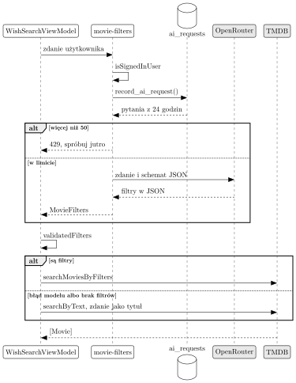
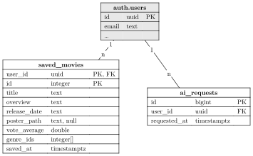

# Lab 7: wyszukiwanie z AI ("Mam ochotę na...")

Na tych zajęciach ekran Search dostaje przycisk "Ask AI". Użytkownik pisze jedno zdanie, np. "coś lekkiego z Keanu z lat 90", a aplikacja pokazuje pasujące filmy.

Do wyboru są dwie ścieżki, wystarczy jedna:

- ścieżka A: model w chmurze, na OpenRouterze, z kluczem API schowanym w funkcji movie-filters w Supabase (zadanie 1),
- ścieżka B: model lokalnie na macOS, w llama.cpp, bez klucza i konta (zadanie 5).

Obie dają w aplikacji ten sam wynik i obie są tak samo oceniane. Zadania 2, 3 i 4 są wspólne. Kto chce, może zrobić obie ścieżki i przełączać się między nimi jednym ustawieniem. Opis jest na końcu zadania 5.

Cały kod aplikacji piszą Państwo sami. Nazwy plików, typów i funkcji proszę zachować, bo według nich sprawdzam prace. Gotowe są pliki w supabase/: funkcja movie-filters i migracja.

## Zanim Państwo zaczną

1. Lab 6 nie jest potrzebny.
2. Ścieżka A korzysta z logowania z lab 5, bo funkcja w Supabase odpowiada tylko zalogowanym. W projekcie są supabase/functions/movie-filters/index.ts, supabase/functions/\_shared/auth.ts i supabase/migrations/...\_create\_ai\_requests.sql. Jeśli ich nie ma, proszę skopiować folder supabase/ z aktualnego ZIP-a repozytorium przedmiotu.
3. Ścieżka B potrzebuje około 8 GB wolnego miejsca na dysku na model.

## Pliki

Nowe:

```
MyNextMovie/Models/MovieFilters.swift
MyNextMovie/Services/LocalModel.swift
MyNextMovie/ViewModels/WishSearchViewModel.swift
MyNextMovie/Views/Components/SearchResults.swift
MyNextMovieTests/MovieFiltersTests.swift
MyNextMovieTests/FilteredSearchTests.swift
MyNextMovieTests/LocalModelTests.swift
MyNextMovieTests/WishSearchViewModelTests.swift
```

Do zmiany:

```
MyNextMovie/MyNextMovieApp.swift
MyNextMovie/Config/AppConfig.swift
MyNextMovie/Services/MovieLoader.swift
MyNextMovie/Services/Supabase.swift
MyNextMovie/Services/TMDB.swift
MyNextMovie/Views/SearchView.swift
MyNextMovie/Views/Components/Layout.swift
Config/App.xcconfig
Config/Info.plist
supabase/config.toml
```

## Jak to działa

Model językowy nie zna nowych filmów i potrafi zmyślić tytuł. Dlatego nie pytamy go o filmy, tylko o filtry: gatunki, lata, osoby, słowa kluczowe, tytuł. Filmy znajduje TMDB. Gdy model zawiedzie, aplikacja traktuje zdanie jak zwykły tytuł.

Klucz OpenRoutera jest tylko w funkcji w Supabase, nigdy w aplikacji. Funkcja odpowiada tylko zalogowanym, najwyżej 50 razy na dobę na konto. Na diagramie szare są usługi zewnętrzne:



W ścieżce B aplikacja pyta lokalny model bezpośrednio, z tymi samymi instrukcjami i tym samym schematem JSON. Nie ma klucza ani limitu, bo model nic nie kosztuje. Logowanie, TMDB i zapisane filmy dalej idą przez Supabase. Symulator działa na tym samym komputerze, więc widzi model pod adresem 127.0.0.1. Prawdziwy iPhone go nie widzi, dlatego ścieżka B działa tylko w symulatorze.

## Zadanie 1: funkcja w Supabase (ścieżka A)

### Klucz OpenRoutera

Proszę założyć konto na [openrouter.ai](https://openrouter.ai), a potem wybrać menu konta, Keys, Create Key. Klucz zaczyna się od sk-or- i widać go tylko raz. Doładowanie nie jest potrzebne, bo funkcja używa darmowego modelu nvidia/nemotron-3.5-super-vl:free. Darmowe modele na OpenRouterze czasem znikają. Wtedy proszę wybrać inny model z ":free" w nazwie z [listy modeli ze schematem JSON](https://openrouter.ai/models?supported_parameters=structured_outputs) i ustawić go poleceniem supabase secrets set OPENROUTER\_MODEL=....

### supabase/config.toml

Przed linią \[analytics\]:

```toml
[functions.movie-filters]
verify_jwt = true
```

### Terminal

W folderze projektu:

```sh
supabase db push
supabase secrets set OPENROUTER_API_KEY=sk-or-...
supabase functions deploy movie-filters
```

Polecenie db push tworzy tabelę ai\_requests. Obok niej na diagramie ERD jest tabela z lab 5:



### Panel Supabase

Proszę sprawdzić:

1. Table Editor: jest ai\_requests.
2. Edge Functions: jest movie-filters.
3. Edge Functions, Secrets: jest OPENROUTER\_API\_KEY.

Gdy funkcja zgłosi błąd o polityce danych, proszę na openrouter.ai, w Settings, Privacy, włączyć darmowe modele.

## Zadanie 2: filtry

### Models/MovieFilters.swift

```swift
nonisolated struct MovieFilters: Codable, Equatable {
    let genreIds: [Int]
    let fromYear: Int  // noYear when there is no lower limit
    let toYear: Int
    let people: [String]
    let keywords: [String]
    let title: String
}

let noYear = 0
let earliestMovieYear = 1880
let yearsAheadOfToday = 5
let maxFilterValues = 3
```

Do tego stała noMovieFilters, w której wszystko jest puste.

| Funkcja | Co robi |
| --- | --- |
| validatedFilters(\_:currentYear:) | gatunki tylko z genreTable, lata od 1880 do bieżącego roku plus 5, we właściwej kolejności, bez pustych i powtórzonych nazw, najwyżej 3 wartości każdego rodzaju |
| hasAnyFilter(\_:) | czy jest choć jeden filtr |
| moviesMatchingFilters(\_:\_:) | filmy z którymś z gatunków i z rokiem premiery w zakresie |
| filtersSummary(\_:) | filtry rozdzielone kropką środkową, `" \u{00B7} "` |
| yearRangeText(fromYear:toYear:) | lata z półpauzą `"\u{2013}"` między nimi, "1990 or later", "up to 1999" |

### Testy

Testy w pliku MyNextMovieTests/MovieFiltersTests.swift.

MovieFiltersValidationTests:

```
keepsValidFilters
dropsUnknownAndRepeatedGenres
keepsAtMostThreeOfEach
dropsYearsOutOfRange
swapsYearsInWrongOrder
trimsAndDropsEmptyOrRepeatedNames
emptyFiltersHaveNoFilter
onlyUnknownGenresLeaveNoFilter
```

MovieFiltersTextTests:

```
summaryListsEveryFilter
yearRangeTextCoversEveryCase
decodesAnswerOfTheFunction
errorAnswerShowsItsMessage
```

Test errorAnswerShowsItsMessage sprawdza functionErrorMessage z Supabase.swift, więc piszą go tylko osoby ze ścieżki A.

## Zadanie 3: zapytania

### Services/MovieLoader.swift

Na końcu:

```swift
typealias MovieWishParser =
    (_ wish: String) async throws -> MovieFilters
typealias FilteredMovieSearch =
    (_ filters: MovieFilters) async throws -> [Movie]
```

### Services/Supabase.swift (ścieżka A)

Nad częścią z klientem:

```swift
let supabaseFunctionMovieFilters = "movie-filters"

nonisolated struct MovieWishRequest: Encodable {
    let wish: String
}

func parseWishWithAI(_ wish: String) async throws
    -> MovieFilters
{
    let client = try requireSupabaseClient()
    let options = FunctionInvokeOptions(
        body: MovieWishRequest(wish: wish))
    do {
        return try await client.functions.invoke(
            supabaseFunctionMovieFilters, options: options)
    } catch FunctionsError.httpError(let status, let data) {
        throw SupabaseError(
            message: functionErrorMessage(
                statusCode: status, data: data))
    }
}
```

Funkcja functionErrorMessage(statusCode:data:) czyta `{"message": "..."}` z odpowiedzi błędu, np. komunikat o dziennym limicie. Gdy komunikatu nie ma, zwraca tekst z numerem statusu.

### Services/TMDB.swift

Zapytanie jako struktura, żeby testy obeszły się bez sieci:

```swift
nonisolated struct TMDBRequest: Equatable {
    let path: String
    let parameters: [URLQueryItem]
}

typealias TMDBFetch =
    @MainActor (_ request: TMDBRequest) async throws -> Data

func fetchTMDBRequest(_ request: TMDBRequest) async throws
    -> Data
{
    let apiKey = try requireTMDBAPIKey()
    let address = tmdbURL(
        path: request.path,
        parameters: request.parameters, apiKey: apiKey)
    return try await fetchTMDBData(address)
}
```

Stałe:

```swift
let tmdbPathDiscoverMovies = "/3/discover/movie"
let tmdbPathSearchPeople = "/3/search/person"
let tmdbPathSearchKeywords = "/3/search/keyword"
let noTMDBId = 0
```

| Funkcja | Co robi |
| --- | --- |
| searchTMDBMoviesByFilters(\_:) | `searchMoviesByFilters(filters, fetch: fetchTMDBRequest)` |
| searchMoviesByFilters(\_:fetch:) | zasady niżej |
| tmdbDiscoverRequest(\_:personIds:keywordIds:) | /discover/movie z filtrami |
| tmdbNameSearchRequest(path:name:) | szukanie osoby, słowa kluczowego albo tytułu |
| decodeFirstTMDBId(\_:) | id pierwszego wyniku, noTMDBId, gdy wyników nie ma |

Zasady searchMoviesByFilters:

1. Jest tytuł: /search/movie, potem moviesMatchingFilters.
2. Bez tytułu: zamienia nazwy osób i słów kluczowych na id, wszystkie naraz (`async let` i withThrowingTaskGroup).
3. Jest nieznana osoba: pusty wynik.
4. Nie został żaden filtr: pusty wynik, bo /discover/movie bez filtrów zwraca popularne filmy.
5. W pozostałych przypadkach jedno zapytanie /discover/movie. Gatunki i słowa kluczowe łączy `|` (wystarczy jeden), osoby łączy `,` (muszą być wszystkie).

### Testy

Testy w pliku MyNextMovieTests/FilteredSearchTests.swift, dwa zestawy. Funkcję fetch udaje klasa w pliku testów: zapisuje zapytania i odpowiada gotowym JSON-em.

FilteredSearchTests:

```
namesBecomeIdsInOneDiscoverRequest
looksUpEveryNameAtOnce
unknownPersonFindsNothing
onlyUnknownKeywordsFindNothing
unknownKeywordNextToGenreStillSearches
titleSearchKeepsYearsAndGenres
```

MoviesMatchingFiltersTests:

```
withoutGenresAndYearsAllMatch
anyOfTheGenresMatches
movieWithoutYearDoesNotMatchYears
yearsIncludeBothEnds
```

W pliku MovieFiltersTests.swift jest jeszcze zestaw DiscoverRequestTests:

```
withoutFiltersHasNoParameters
anyGenreAndKeywordButEveryPerson
yearsCoverWholeYears
nameSearchSendsTheName
firstIdIsTheBestMatch
```

## Zadanie 4: ekran

### ViewModels/WishSearchViewModel.swift

Klasa @Observable z init(parseWish:searchByFilters:searchByText:currentYear:). Parametr currentYear ma wartość domyślną: bieżący rok z funkcji yearOfToday(). Testy podają własny rok. Pola: wish, state, movies, errorMessage, filters, plainSearchReason.

Metoda search() przy pustym zdaniu (po obcięciu spacji i nowych linii) nic nie robi. W przeciwnym razie:

1. Pyta model i poprawia odpowiedź przez validatedFilters.
2. Gdy model zawiedzie albo nie ma filtrów: zapisuje powód w plainSearchReason, potem woła `searchByText(wish, noGenreId)`.
3. Inaczej woła searchByFilters(filters).

Właściwości:

- isPlainSearch: plainSearchReason nie jest pusty,
- canSearch: zdanie nie jest puste i nic się teraz nie ładuje.

### Views/Components/SearchResults.swift

Proszę przenieść tu z SearchView.swift struktury SearchResults i SearchResultRow razem z ich stałymi i usunąć przy nich private, bo korzystają z nich oba wyszukiwania.

### Views/Components/Layout.swift

```swift
let symbolNameWish = "sparkles"
```

### Views/SearchView.swift

- init(viewModel:wishViewModel:loadDetails:), wishViewModel w @State, jak viewModel.
- `@State private var isShowingAIResults = false`.
- W VStack pod genreFilter: gdy w polu jest tekst, przycisk "Ask AI" z ikoną symbolNameWish. Gdy isShowingAIResults, zamiast przycisku szara linia z filtersSummary albo z powodem zwykłego wyszukiwania.
- content: gdy isShowingAIResults, pokazuje wyniki wishViewModel, a w przeciwnym razie to samo co dotąd.

Przycisk i klawisz wyszukiwania wywołują tę samą funkcję:

```swift
private func askAI() {
    // at most 200 characters
    wishViewModel.wish = viewModel.query
    isShowingAIResults = true
    Task { await wishViewModel.search() }
}
```

Przy .searchable:

```swift
.onSubmit(of: .search, askAI)
.onChange(of: viewModel.query) {
    isShowingAIResults = false
}
.onChange(of: viewModel.selectedGenreId) {
    isShowingAIResults = false
}
```

### MyNextMovieApp.swift

W AppTabs, we właściwości search:

```swift
let wishViewModel = WishSearchViewModel(
    parseWish: parseWishWithAI,
    searchByFilters: searchTMDBMoviesByFilters,
    searchByText: searchTMDBMovies)
return SearchView(
    viewModel: viewModel,
    wishViewModel: wishViewModel, loadDetails: loadDetails)
```

W ścieżce B zamiast parseWishWithAI jest parseWishWithLocalModel z zadania 5.

### Testy

Testy w pliku MyNextMovieTests/WishSearchViewModelTests.swift:

```
searchesWithTheFiltersOfTheModel
checksTheModelAnswerBeforeSearching
fallsBackToTextSearchWhenTheModelFails
fallsBackToTextSearchWithoutFilters
showsErrorWhenTheMovieSearchFails
emptyWishDoesNothing
nextSearchForgetsThePlainSearchReason
```

Proszę sprawdzić w aplikacji:

1. Wpisanie "matrix" działa jak wcześniej.
2. Zdanie "something light with Keanu from the 90s" i przycisk "Ask AI" dają filmy z Keanu Reevesem z lat dziewięćdziesiątych, a nad nimi filtry.
3. Zdanie po polsku też działa.
4. W ścieżce A: w panelu, w Table Editor, tabela ai\_requests ma wiersz na każde pytanie.

## Zadanie 5: lokalny model na macOS (ścieżka B)

### Jak to działa

Model działa lokalnie na macOS jako osobny program, llama-server. Aplikacja w symulatorze łączy się z nim przez sieć, tak samo jak z serwerem w internecie:

1. W terminalu uruchamiają Państwo llama-server. To zwykły program na macOS: ładuje model do pamięci i wykonuje obliczenia na karcie graficznej. Działa jak mały serwer HTTP pod adresem `http://127.0.0.1:8080`.
2. Symulator iPhone'a też jest programem na tym samym komputerze. Dla niego adres 127.0.0.1 to ten komputer, więc symulator łączy się z llama-server.
3. Po dotknięciu "Ask AI" aplikacja wysyła zdanie w zapytaniu POST na adres `http://127.0.0.1:8080/v1/chat/completions`.
4. llama-server przepuszcza zdanie przez model i po kilku sekundach odsyła JSON z filtrami.
5. Dalej wszystko idzie jak w ścieżce A: aplikacja sprawdza filtry przez validatedFilters i pyta TMDB o filmy.

W oknie terminala z llama-server widać każde zapytanie. Po zamknięciu tego okna aplikacja nie dostaje odpowiedzi i traktuje zdanie jak zwykły tytuł.

W ścieżce A jest tak samo, tylko serwer z modelem jest w internecie, za funkcją w Supabase. Dla aplikacji różni się tylko adres, pod który wysyła zdanie.

Na prawdziwym iPhonie ścieżka B nie zadziała. Dla telefonu 127.0.0.1 to sam telefon, a na nim nie działa żaden llama-server. Dlatego ścieżkę B sprawdzamy w symulatorze.

### llama.cpp

[llama.cpp](https://github.com/ggml-org/llama.cpp) uruchamia model na karcie graficznej i udostępnia go przez takie samo API jak OpenAI. Instalacja przez [Homebrew](https://brew.sh):

```sh
brew install llama.cpp
```

### Model

Używamy modelu Gemma 3 12B od Google (około 7,3 GB). Pierwsze uruchomienie pobiera model:

```sh
llama-server -hf ggml-org/gemma-3-12b-it-GGUF:Q4_K_M \
    --port 8080
```

Serwer jest gotowy, gdy wypisze `server is listening on http://127.0.0.1:8080`. Jeśli pobieranie się zatrzyma, wystarczy nacisnąć Ctrl+C i uruchomić to samo polecenie jeszcze raz. Pobieranie wznowi się od miejsca, w którym się zatrzymało. Serwer ma działać w osobnym oknie terminala przez cały czas pracy z aplikacją.

Sprawdzenie w drugim oknie:

```sh
curl http://127.0.0.1:8080/health
```

Odpowiedź to `{"status":"ok"}`.

Mniejsze modele, np. Gemma 3 4B albo Qwen3 4B, odpowiadają szybciej, ale gorzej. Dopisują lata, o które nikt nie pytał, albo słowa kluczowe, przez które TMDB nie znajduje żadnego filmu. Proszę zostać przy 12B.

### Config/App.xcconfig

Pod SUPABASE\_ANON\_KEY:

```
LOCAL_MODEL_URL =
```

W Config/Secrets.xcconfig, tylko u siebie:

```
LOCAL_MODEL_URL = http:/$()/127.0.0.1:8080
```

Pusta wartość oznacza ścieżkę A. Zapis `$()` jest potrzebny, bo w xcconfig `//` zaczyna komentarz.

### Config/Info.plist

Dwa nowe klucze w głównym `<dict>`:

```xml
<key>LocalModelURL</key>
<string>$(LOCAL_MODEL_URL)</string>
<key>NSAppTransportSecurity</key>
<dict>
    <key>NSAllowsLocalNetworking</key>
    <true/>
</dict>
```

App Transport Security domyślnie blokuje adresy http. NSAllowsLocalNetworking zezwala tylko na adresy lokalne, takie jak 127.0.0.1.

### Config/AppConfig.swift

Funkcja localModelURL() czyta klucz "LocalModelURL", tak jak supabaseURL() czyta swój.

### Services/LocalModel.swift

Stałe:

```swift
let localModelChatPath = "/v1/chat/completions"
let localModelMaxAnswerTokens = 300
let localModelTimeoutSeconds = 30.0
```

Stała httpStatusOK jest już w TMDB.swift z lab 3.

Limit czasu jest dwa razy dłuższy niż w movie-filters. Pierwsza odpowiedź po załadowaniu modelu trwa około 15 sekund, następne około 5.

Z odpowiedzi serwera potrzebna jest tylko treść `choices[0].message.content`:

```swift
nonisolated struct ChatCompletion: Decodable {
    let choices: [ChatChoice]
}

nonisolated struct ChatChoice: Decodable {
    let message: ChatMessage
}

nonisolated struct ChatMessage: Decodable {
    let content: String
}
```

Do tego struktura LocalModelError z polem message, zbudowana tak jak SupabaseError.

| Funkcja | Co robi |
| --- | --- |
| localModelInstructions() | instrukcje ze stałej instructions w movie-filters/index.ts, z gatunkami z genreTable w postaci "35 Comedy" |
| movieFiltersSchema | stała z JSON-em ze stałej filtersSchema w movie-filters/index.ts |
| localModelRequestBody(wish:) | JSON zapytania: temperature 0, max\_tokens, messages (system i user), response\_format z json\_schema |
| decodeLocalModelFilters(\_:) | MovieFilters z treści odpowiedzi albo LocalModelError, gdy odpowiedzi nie ma lub treść nie jest JSON-em z filtrami |
| localModelConnectionMessage(\_:) | komunikat, gdy serwer nie odpowiedział: osobny dla przekroczonego czasu (URLError z kodem .timedOut), osobny dla wyłączonego serwera |
| parseWishWithLocalModel(\_:) | MovieWishParser: POST na localModelURL() + localModelChatPath |

Obie ścieżki naraz (dla chętnych): funkcja chosenWishParser() zwraca parseWishWithAI, gdy localModelURL() jest pusty, a inaczej parseWishWithLocalModel. AppTabs przekazuje wtedy `parseWish: chosenWishParser()`, a ścieżkę zmienia się w Secrets.xcconfig.

Gdy serwer nie działa, parseWishWithLocalModel rzuca LocalModelError z tekstem "The local model is not running. Start llama-server." Gdy serwer działa, ale nie odpowie w ciągu 30 sekund, tekst brzmi "The local model took too long to answer. Try again." Aplikacja pokazuje komunikat nad wynikami zwykłego wyszukiwania.

### Testy

Testy w pliku MyNextMovieTests/LocalModelTests.swift. Nie łączą się z serwerem, zamiast jego odpowiedzi dostają gotowy JSON.

```
decodesFiltersFromTheChatAnswer
answerWithoutFiltersIsAnError
answerWithoutChoicesIsAnError
timeoutIsNotAStoppedServer
requestSendsTheWishAndTheSchema
instructionsListEveryGenre
```

Proszę sprawdzić w aplikacji, przy działającym llama-server:

1. Zdanie "coś lekkiego z Keanu z lat 90" daje komedie z Keanu Reevesem z lat dziewięćdziesiątych.
2. W oknie llama-server widać każde zapytanie.
3. Po zatrzymaniu llama-server aplikacja pokazuje komunikat i wyniki zwykłego wyszukiwania.

## Checklista

### Przygotowanie

- [ ] Ścieżka A: logowanie z lab 5 działa, w supabase/ są movie-filters, \_shared/auth.ts i migracja ai\_requests.
- [ ] Wybrana ścieżka: A (klucz API) albo B (lokalny model na macOS).
- [ ] Ścieżka B: model Gemma 3 12B jest pobrany.

### Zadanie 1: funkcja w Supabase (ścieżka A)

- [ ] Klucz OpenRoutera jest utworzony.
- [ ] config.toml: \[functions.movie-filters\] z verify\_jwt = true.
- [ ] W terminalu: db push, secrets set, functions deploy.
- [ ] W panelu: tabela ai\_requests, funkcja movie-filters, sekret OPENROUTER\_API\_KEY.

### Zadanie 2: filtry

- [ ] MovieFilters.swift: struktura, stałe i funkcje z tabeli.
- [ ] Testy MovieFiltersValidationTests i MovieFiltersTextTests.

### Zadanie 3: zapytania

- [ ] MovieLoader.swift: MovieWishParser, FilteredMovieSearch.
- [ ] Ścieżka A: Supabase.swift: parseWishWithAI, functionErrorMessage.
- [ ] TMDB.swift: TMDBRequest, TMDBFetch, fetchTMDBRequest, stałe ścieżek.
- [ ] searchMoviesByFilters według pięciu zasad.
- [ ] Testy FilteredSearchTests, MoviesMatchingFiltersTests, DiscoverRequestTests.

### Zadanie 4: ekran

- [ ] WishSearchViewModel z search i isPlainSearch.
- [ ] SearchResults i SearchResultRow w osobnym pliku.
- [ ] Layout.swift: symbolNameWish.
- [ ] SearchView: przycisk "Ask AI", linia z filtrami, wyniki AI, askAI na klawiszu wyszukiwania.
- [ ] AppTabs tworzy WishSearchViewModel z parserem wybranej ścieżki.
- [ ] Testy WishSearchViewModelTests.
- [ ] W aplikacji: zdanie po angielsku i po polsku daje filmy. W ścieżce A w ai\_requests przybywa wierszy.

### Zadanie 5: lokalny model na macOS (ścieżka B)

- [ ] llama-server działa, /health odpowiada ok.
- [ ] App.xcconfig i Secrets.xcconfig: LOCAL\_MODEL\_URL.
- [ ] Info.plist: LocalModelURL i NSAllowsLocalNetworking.
- [ ] AppConfig.swift: localModelURL().
- [ ] LocalModel.swift: stałe, struktury odpowiedzi, funkcje z tabeli.
- [ ] Testy LocalModelTests.
- [ ] W aplikacji: zdanie po polsku daje filmy, bez llama-server jest komunikat i zwykłe wyszukiwanie.

## Dokumentacja

- OpenRouter: https://openrouter.ai/docs/quickstart
- Supabase Edge Functions: https://supabase.com/docs/guides/functions
- Supabase, funkcje w Swift: https://supabase.com/docs/reference/swift/functions-invoke
- TMDB, discover: https://developer.themoviedb.org/reference/discover-movie
- llama.cpp, serwer: https://github.com/ggml-org/llama.cpp/tree/master/tools/server
- App Transport Security: https://developer.apple.com/documentation/bundleresources/information-property-list/nsapptransportsecurity
